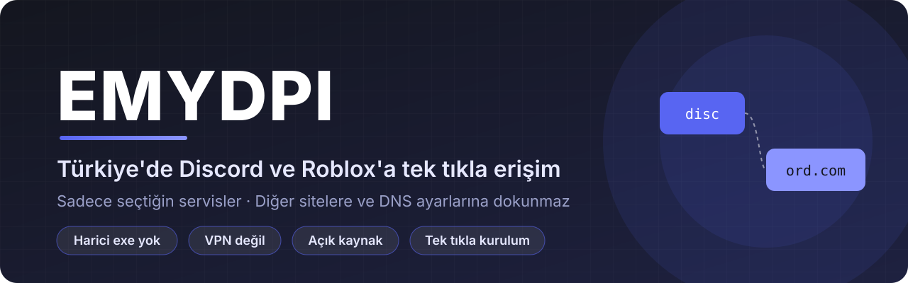
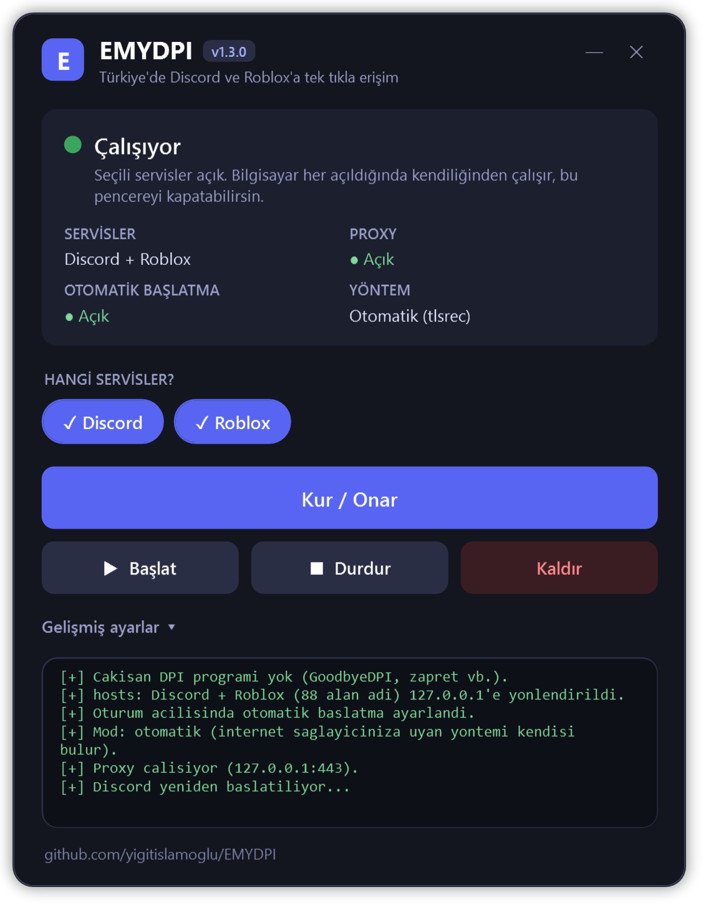
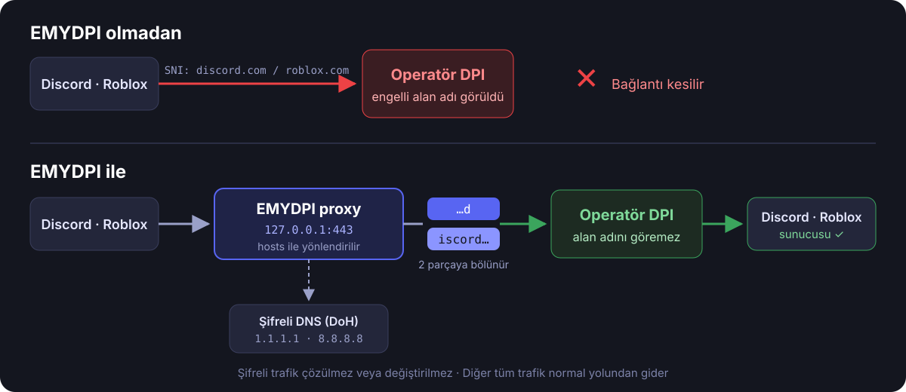

<p align="center">
  
</p>

<p align="center">
  <a href="https://github.com/yigitislamoglu/EMYDPI/releases/latest"></a>
  <a href="https://github.com/yigitislamoglu/EMYDPI/releases"></a>
  
  <a href="LICENSE"></a>
  <a href="https://github.com/yigitislamoglu/EMYDPI/stargazers"></a>
</p>

<p align="center">
  
  
</p>

<p align="center">
  <a href="https://github.com/yigitislamoglu/EMYDPI/releases/latest/download/EMYDPI.zip">
    
  </a>
</p>

---

**EMYDPI**, Türkiye'deki **Discord** ve **Roblox** engellerini aşmak için yazılmış küçük ve açık kaynaklı bir araçtır.
Sadece seçtiğin servislerin trafiğini etkiler; diğer sitelere, DNS ayarlarına ve internet hızına dokunmaz.

| | |
|---|---|
| 🎮 **Discord + Roblox** | İkisi birden ya da sadece biri. Kurulumda sen seçersin. |
| 🧩 **Harici dosya yok** | `.exe`, `.dll`, sürücü yok. Sadece Windows'ta zaten bulunan PowerShell; tüm kod açık ve okunabilir. |
| 🔒 **VPN değil** | Trafiğin başka bir sunucuya gitmez, doğrudan Discord'a / Roblox'a bağlanırsın. Ping artmaz. |
| 🎯 **Sadece seçtiğin servisler** | Yalnızca o servislerin alan adları yönlendirilir, geri kalan her şey normal yolundan gider. |
| 🛡️ **Uygulamalara dokunmaz** | DLL enjekte etmez, Discord'un veya Roblox'un dosyalarını değiştirmez. Güncellemeler sorun çıkarmaz. |
| ⚡ **Kur ve unut** | Bilgisayar her açıldığında arka planda, pencere açmadan kendiliğinden çalışır. |
| 🌐 **Her operatöre uyum** | Türk Telekom, Superonline, Vodafone, TurkNet… Her operatörün DPI'ı farklı davranabilir. EMYDPI 4 farklı yöntemi sırayla dener, senin hattında işe yarayanı kendisi bulur ve hatırlar. |

## 🚀 Kurulum

> [!CAUTION]
> **Önce diğer DPI araçlarını tamamen kaldır!** GoodbyeDPI, zapret, DPIscord, SpoofDPI, ByeDPI, GreenTunnel,
> PowerTunnel ve benzerleri EMYDPI ile **aynı anda çalışamaz**. İkisi birden trafiği değiştirmeye çalışır ve
> bağlantı bozulur. Ayrıca Discord için açık bir **VPN** veya **proxy** varsa onu da kapat.
>
> - **GoodbyeDPI:** klasöründeki `service_remove.cmd`'yi yönetici olarak çalıştır, sonra klasörü sil.
> - **zapret:** `service.bat` → *Remove Services*, sonra klasörü sil.
> - **Diğerleri:** kendi kaldırma adımlarıyla kaldır, otomatik başlatmadan çıkar.
>
> Unutursan sorun değil: `Kur / Onar` bunları **otomatik tespit eder**, seni uyarır ve istersen durdurur.
> Başka araçların `hosts` dosyasına eklediği eski Discord/Roblox satırlarını da kendisi temizler.

1. **[EMYDPI.zip](https://github.com/yigitislamoglu/EMYDPI/releases/latest/download/EMYDPI.zip)** dosyasını indir
   ve bir klasöre çıkar (örneğin `Belgeler\EMYDPI`).
2. `EMYDPI.bat` dosyasına çift tıkla, yönetici iznine **Evet** de. EMYDPI penceresi açılır.
3. **Hangi servisler?** bölümünden Discord'u, Roblox'u ya da ikisini seç, **`Kur / Onar`** butonuna bas.

Hepsi bu. Discord kendiliğinden yeniden açılır; Roblox'u da normal şekilde açabilirsin. Durum yeşil
**"Çalışıyor"** olduğunda pencereyi kapatabilirsin; EMYDPI arka planda çalışmaya devam eder. 🎉

<p align="center">
  
</p>

> [!IMPORTANT]
> Klasörü kurulumdan sonra **taşıma veya silme**; otomatik başlatma bu klasördeki dosyaları kullanır.
> Taşıman gerekirse yeni yerinde `Kur / Onar`'ı bir kez daha çalıştır.

> [!WARNING]
> **Kaspersky vb. antivirüs kullanıyorsan:** kurulum Windows'un `hosts` dosyasına birkaç satır ekler. Bazı
> antivirüsler bu dosyayı korur ve **"hosts dosyasına yazma ENGELLENDİ"** hatası görürsün. Antivirüsü birkaç
> dakikalığına duraklat, kurulumu tekrar çalıştır, sonra antivirüsü geri aç. Bu sadece kurulum, servis değiştirme ve
> kaldırmada gerekir.

### Eski sürümden güncelliyorsan

Yeni ZIP'i **aynı klasöre** çıkarıp dosyaların üzerine yaz, sonra `EMYDPI.bat` → istediğin servisleri seç →
**`Kur / Onar`**.

### Sistem gereksinimleri

| | |
|---|---|
| ✅ **Windows 10** (1809 ve sonrası) / **Windows 11** | Home, Pro, Education. Ek program kurmaya gerek yok. |
| ✅ **Yönetici izni** | Sadece kurulum ve kaldırmada (hosts dosyası ve otomatik başlatma için). |
| ❌ **Windows 7 / 8 / 8.1** | Desteklenmez. Kurulum bunu kontrol eder ve uyarır. |
| ⚠️ **İş / okul bilgisayarı** | PowerShell yönetici tarafından kısıtlanmışsa çalışmaz. Kurulum bunu da kontrol eder. |
| ⚠️ **443 portu boş olmalı** | XAMPP/Apache, IIS, VMware gibi 443'ü kullanan bir program açıksa kurulum seni uyarır. |

## 🖱️ Arayüz

| Buton | Ne yapar |
|---|---|
| **Hangi servisler?** | Discord, Roblox ya da ikisi. Seçim `Kur / Onar` ile uygulanır |
| `Kur / Onar` | Çakışan programları kontrol eder, hosts kayıtlarını ekler, proxy'yi başlatır, açılışta otomatik çalışmayı ayarlar. Bir sorun olursa tekrar basman yeterli |
| `Başlat` | Proxy'yi (yeniden) başlatır, Discord'u yeniden açar |
| `Durdur` | Proxy'yi durdurur (kurulum kalır) |
| `Kaldır` | Her şeyi geri alır: proxy, otomatik başlatma, hosts kayıtları |
| *Gelişmiş ayarlar* → **Atlatma yöntemi** | Otomatik mod yerine tek bir yöntemi sabitler (sorun giderme için, normalde gerekmez) |
| *Gelişmiş ayarlar* → `Logu göster` | Son bağlantı kayıtlarını gösterir |

Üstteki durum kartı her şeyi tek bakışta gösterir: **yeşil** çalışıyor, **turuncu** bir şey eksik, **gri** kurulu
değil. GoodbyeDPI gibi çakışan bir program çalışıyorsa kırmızı bir uyarı çıkar.

<details>
<summary>Yazı menüsünü tercih edenler için</summary>

Eski numaralı menü hâlâ duruyor. Komut isteminde EMYDPI klasöründeyken:

```bat
EMYDPI.bat konsol
```
</details>

## 🔍 Nasıl çalışıyor?

<p align="center">
  
</p>

Türkiye'deki engeller **DPI / SNI** tabanlıdır. HTTPS bağlantısı başlarken, gidilmek istenen sitenin adı (SNI)
şifrelenmemiş olarak gönderilir. Operatör bu paketi okur, içinde `discord.com` veya `roblox.com` görürse bağlantıyı
keser. Discord'da buna ek olarak DNS engeli de vardır. Bu yüzden sadece DNS'i değiştirmek **yetmez**.

EMYDPI şöyle aşar:

1. `hosts` dosyası seçilen servislerin alan adlarını bilgisayarın kendisine (`127.0.0.1`) yönlendirir.
2. Yerel **EMYDPI proxy** bağlantıyı karşılar ve gerçek IP'yi **şifreli DNS (DoH)** ile bulur. Cloudflare,
   Google ve AdGuard'ın 6 farklı sunucusu sırayla denenir; biri engellenirse diğerine geçilir.
3. TLS **ClientHello** paketini alan adının ortasından bölerek gönderir. DPI alan adının tamamını göremediği için
   bağlantıyı kesmez.
4. **Otomatik mod:** Operatörlerin DPI cihazları farklıdır. Bir yöntem cevap almazsa proxy aynı bağlantıyı bir
   sonraki yöntemle tekrar dener. İşe yarayanı kaydeder; sonraki bağlantılar ve bilgisayar açılışları doğrudan onu
   kullanır. Operatörün davranışı değişirse yeniden öğrenir.

| Yöntem | Ne yapar | Hız |
|---|---|---|
| `tlsrec` | ClientHello'yu alan adının 1. harfinden **iki TLS kaydına** böler | En hızlı |
| `multi` | Alan adını **3'er harflik çok sayıda TLS kaydına** böler | Hızlı |
| `recfrag` | `tlsrec` + alan adı bölümünü **1 baytlık TCP paketleriyle** gönderir | Orta |
| `frag` | Paketin başını **2 baytlık TCP parçalarıyla** gönderir | Yavaş, son çare |

Şifreli trafik **çözülmez veya değiştirilmez**; proxy sadece ilk paketi böler, gerisini olduğu gibi aktarır.
Bu yüzden sertifika kurulumu da gerekmez.

> [!NOTE]
> **Roblox oyun sunucuları** (oyun içi bağlantı) UDP ile doğrudan IP'ye bağlanır ve şu an engelli değildir; proxy'den
> geçmesine gerek yoktur. EMYDPI Roblox'un giriş, site, API ve oyuna katılma bağlantılarını açar.

📖 **Ayrıntılı teknik açıklama:** [NASIL-CALISIR.md](NASIL-CALISIR.md). Engelin nasıl uygulandığını, bir bağlantının
adım adım yolculuğunu, kurulumda ve bilgisayar açılışında neler olduğunu orada bulabilirsin.

<details>
<summary><b>Dosyalar ve sisteme yapılan değişiklikler</b></summary>

| Dosya | Görev |
|---|---|
| [`EMYDPI.bat`](EMYDPI.bat) | Başlatıcı: yönetici izni ister, arayüzü açar (`konsol` ile yazı menüsü) |
| [`emydpi-gui.ps1`](emydpi-gui.ps1) | Arayüz (WPF, Windows'un kendi bileşeni). İşlemleri `emydpi.ps1`'e yaptırır |
| [`emydpi.ps1`](emydpi.ps1) | Kurulum/kaldırma, servis listeleri, hosts ve zamanlanmış görev yönetimi |
| [`emydpi-proxy.cs`](emydpi-proxy.cs) | Proxy'nin kendisi (C#, çalışırken PowerShell tarafından derlenir) |
| [`emydpi-proxy.ps1`](emydpi-proxy.ps1) | Proxy'yi derleyip başlatır |

**Sisteme yapılan değişiklikler:**

- `C:\Windows\System32\drivers\etc\hosts` dosyasına `# >>> EMYDPI` ile başlayan bir blok eklenir.
  İlk değişiklikten önce yedeği `hosts.emydpi.bak` olarak alınır.
- EMYDPI klasörüne `emydpi.log` ve `emydpi-strategy.txt` (otomatik modun öğrendiği yöntem) yazılır.
- Görev Zamanlayıcı'ya **EMYDPI** adlı, oturum açılışında çalışan bir görev eklenir. Bu görev yönetici yetkisiyle
  değil, normal kullanıcı olarak ve pencere açmadan çalışır.

`Kaldır` bunların hepsini geri alır.

**Yönlendirilen alan adları:**

- **Discord:** `discord.com`, `discord.gg`, `discordapp.com`, `discordapp.net`, `discord.media`, `discordcdn.com`
  ve alt alan adları (26 adres)
- **Roblox:** `roblox.com`, `www.roblox.com`, `apis.roblox.com`, `auth.roblox.com`, `gamejoin.roblox.com`,
  `assetdelivery.roblox.com` ve diğer API adresleri (62 adres). `rbxcdn.com` engelli olmadığı için eklenmez.

Tam liste [`emydpi.ps1`](emydpi.ps1) içindedir.

</details>

<a id="performans"></a>
## ⚡ Performans: bilgisayarı yormaz

EMYDPI arka planda sürekli çalışır ama **hissedilmez**. Aşağıdaki değerler gerçek ölçümlerdir:

| Durum | CPU kullanımı | Bellek |
|---|---|---|
| 💤 Boşta | **%0** | ~7 MB |
| 💬 1 saat normal Discord kullanımı | toplam **2,7 saniye** (ortalama %0,0025) | ~7 MB |
| 📥 102 MB dosya indirme, tam hız | işlemcinin **%0,28**'i | ~85 MB |
| 🔀 100 eşzamanlı bağlantı | 0,5 saniye, hepsi başarılı | ~85 MB |

- **Hız kaybı yok:** Aynı 102 MB'lık dosya doğrudan bağlantıda 8,0 MB/sn, EMYDPI üzerinden 9,7 MB/sn indi.
  Sınır senin internet hattın.
- **Ping artmaz:** Proxy senin bilgisayarında çalışır; trafik VPN gibi başka bir ülkeye gitmez.
- **Oyunları etkilemez:** Roblox oyun trafiği, Discord sesli/görüntülü sohbet ve diğer tüm programlar proxy'den
  hiç geçmez.
- **Neden bu kadar hafif?** Proxy sadece her bağlantının ilk paketini (birkaç yüz bayt) böler, gerisini olduğu gibi
  aktarır. CPU'yu en çok yoran şifreleme işlemi yapılmaz.

<a id="guvenlik"></a>
## 🛡️ Güvenlik ve VirusTotal

<p>
  <a href="https://www.virustotal.com/gui/file/9d6e981e0996ecdda762a877cf442f6846e70a7b1104dd9f96546dd0c1701441"></a>
</p>

✅ **VirusTotal: 0/64.** (v1.1.0 taraması; yeni sürümlerin sonucu eklenecek.) EMYDPI v1.1.0, 64 antivirüs motorunun **hiçbiri** tarafından zararlı veya şüpheli
bulunmadı (Avast, AVG, BitDefender, CrowdStrike, Kaspersky, ESET, Microsoft ve diğerleri).
[Sonucu kendin gör →](https://www.virustotal.com/gui/file/9d6e981e0996ecdda762a877cf442f6846e70a7b1104dd9f96546dd0c1701441)

EMYDPI'de **derlenmiş tek bir dosya bile yoktur**: `.exe`, `.dll` veya sürücü bulunmaz. Beş metin dosyasından
oluşur ve her satırı okunabilir. İnternetten hiçbir şey indirmez, hiçbir sunucuya veri göndermez.
Ayrıntılar için [NASIL-CALISIR.md → Güvenlik](NASIL-CALISIR.md#7-güvenlik-ne-yapar-ne-yapmaz).

**İndirdiğin dosyanın değiştirilmediğini doğrula.** İndirdiğin ZIP'in SHA256 değeri aşağıdakiyle aynı olmalı:

```powershell
Get-FileHash .\EMYDPI.zip -Algorithm SHA256
```

| Dosya (v1.3.0) | SHA256 |
|---|---|
| `EMYDPI.zip` | `de195c16f74fb1f5bb61f592847c6cc6b65d457535a5fd8a9b4f8d8a8b6b9712` |
| `EMYDPI.bat` | `8d0085486388fdc42d113a463d84619a70b71b5bfe757e8616643b607867b5ad` |
| `emydpi.ps1` | `0a1b3c1b26b63705c9ad76fb439bf25d0a00e9e3e17c45fe6ea22b0d21bfcbac` |
| `emydpi-gui.ps1` | `62e47424bc8c72de03230caf6fb6eb7ab07f482f7f5f472490b6396ae8b47da1` |
| `emydpi-proxy.ps1` | `bc2090b63b289385a1a976bd4e246aa42f73e8a75a7937166440656e85a44b0a` |
| `emydpi-proxy.cs` | `942f037c6ae001716f5008e49dd0163e980fd26e142a2c93337f007a18fd0fc8` |

> [!NOTE]
> EMYDPI'yi **sadece bu GitHub sayfasından** indir. Başka sitelerde veya Discord sunucularında paylaşılan
> kopyalar değiştirilmiş olabilir. Bazı antivirüsler `hosts` dosyasını değiştiren her betiği şüpheli sayabilir;
> kodu kendin inceleyebilir veya yukarıdaki VirusTotal sonucuna bakabilirsin.

## 🛠️ Sorun giderme

<details>
<summary><b>Discord "Checking for updates…" ekranında kalıyor</b></summary>

1. Durum kartında **"Çakışan program çalışıyor"** uyarısı var mı bak. Varsa o programı kaldır (yukarıdaki
   Kurulum uyarısına bak) ve `Kur / Onar`'a tekrar bas.
2. *Gelişmiş ayarlar* → `Logu göster`'e bas. `discord.com -> ... [tlsrec]` gibi satırlar görünüyorsa proxy çalışıyordur.
   Hiç satır yoksa `Başlat`'a basmayı dene.
3. Logda `tum yontemler denendi` yazıyorsa operatörün henüz desteklenmeyen bir yöntem kullanıyor olabilir.
   Lütfen operatörünün adıyla birlikte bir [Issue](https://github.com/yigitislamoglu/EMYDPI/issues) aç.
</details>

<details>
<summary><b>"EMYDPI ile ÇAKIŞAN programlar bulundu"</b></summary>

GoodbyeDPI, zapret, DPIscord gibi başka bir DPI aracı (veya onun WinDivert sürücüsü) çalışıyor. Kurulum seni
sorduğunda **E** dersen onları durdurur ve otomatik başlamalarını kapatır. Kalıcı çözüm o aracı tamamen kaldırmaktır
(GoodbyeDPI: `service_remove.cmd`, zapret: `service.bat` → *Remove Services*).
</details>

<details>
<summary><b>Roblox açılmıyor veya oyuna girmiyor</b></summary>

1. *Gelişmiş ayarlar* → `Logu göster`'de `roblox.com` satırları görünüyor mu bak. Görünmüyorsa "Hangi servisler?" bölümünde Roblox'un seçili
   olduğundan emin ol.
2. Roblox'u görev yöneticisinden tamamen kapatıp yeniden aç.
3. Logda `cozulemedi` veya `hata` yazan bir Roblox adresi varsa, ya da hiç görünmeyen bir adres yüzünden takılıyorsa
   lütfen bir [Issue](https://github.com/yigitislamoglu/EMYDPI/issues) aç. Listeye ekleyelim.
</details>

<details>
<summary><b>"443 portunu başka bir program kullanıyor"</b></summary>

Bilgisayarında 443 portunu dinleyen bir program var (yerel web sunucusu, IIS, XAMPP, bazı VPN'ler vb.).
O programı kapatıp `Başlat`'a bas.
</details>

<details>
<summary><b>Discord'a / Roblox'a erişim tamamen gitti</b></summary>

Proxy kapalıyken hosts kayıtları duruyorsa bağlantı olmaz. `Başlat` ile proxy'yi başlat ya da `Kaldır` ile tamamen kaldır.
</details>

<details>
<summary><b>Discord'da sesli sohbet çalışmıyor</b></summary>

Ses sunucuları sürekli değişen adlar kullandığı için proxy'den geçmez. Bu yazıldığı tarihte sesli sohbet engelli
değildi; ileride engellenirse lütfen bir [Issue](https://github.com/yigitislamoglu/EMYDPI/issues) aç.
</details>

<details>
<summary><b>Kaldırmak istiyorum</b></summary>

`EMYDPI.bat` → `Kaldır`. Ardından klasörü silebilirsin. Antivirüs hosts dosyasını koruyorsa kaldırma
sırasında da kısa süre duraklatman gerekir.
</details>

## ❓ Sık sorulan sorular

**Güvenli mi?** Tüm kod açık ve birkaç yüz satır. İnternetten hiçbir dosya indirmez, hiçbir şey çalıştırmaz.
Tek dış bağlantısı, gerçek IP adreslerini öğrenmek için Cloudflare (1.1.1.1), Google (8.8.8.8) ve AdGuard
şifreli DNS sunucularına yapılan sorgulardır. VirusTotal sonucu ve dosya özetleri için [Güvenlik](#guvenlik) bölümüne bak.

**Bilgisayarımı yavaşlatır mı?** Hayır. Boşta %0 CPU ve ~7 MB RAM kullanır. Ölçümler [Performans](#performans)
bölümünde.

**Oyunlarda ping'imi artırır mı?** Hayır. VPN değildir; seçilen servisler dışındaki trafiğe dokunmaz. Roblox oyun
trafiği zaten proxy'den geçmez, doğrudan sunucuya gider.

**Roblox hesabım banlanır mı?** EMYDPI Roblox istemcisine veya oyunlara hiçbir şekilde müdahale etmez; sadece
bağlantının operatör tarafından kesilmesini engeller. Roblox açısından normal bir bağlantıdan farkı yoktur.

**GoodbyeDPI / zapret'ten farkı ne?** Onlar WinDivert sürücüsüyle tüm sistemin trafiğini işler. EMYDPI sürücü
kurmaz, sadece seçilen servislerin bağlantılarına müdahale eder. **İkisini birlikte kullanma**; EMYDPI'yi kurmadan
önce onları kaldır.

**Her operatörde çalışır mı?** EMYDPI bunun için tasarlandı: 4 farklı yöntemi sırayla dener ve hattında işe
yarayanı kendisi seçer. Yine de operatörler engelleme yöntemlerini zamanla değiştirebilir. Bir operatörde
çalışmazsa operatörün adıyla bir [Issue](https://github.com/yigitislamoglu/EMYDPI/issues) aç; yeni yöntem ekleyelim.

**Tarayıcıdan girebilir miyim?** Evet, discord.com ve roblox.com tarayıcıdan da açılır. Açılmazsa tarayıcının
"Güvenli DNS" (DoH) ayarını kapatıp tekrar dene; bazı tarayıcılar bu ayar açıkken `hosts` dosyasını atlayabilir.

**Başka bir site/oyun eklenebilir mi?** Aynı yöntemle SNI engeli olan başka servisler de eklenebilir.
İsteğini [Issue](https://github.com/yigitislamoglu/EMYDPI/issues) olarak aç.

## 🤝 Katkı

Hata bildirmek, öneride bulunmak veya geliştirmeye katkıda bulunmak için
[Issue](https://github.com/yigitislamoglu/EMYDPI/issues) veya Pull Request açabilirsin.
Projeyi faydalı bulduysan ⭐ vermeyi unutma.

## ⚖️ Sorumluluk reddi

Bu proje eğitim amaçlıdır ve kişisel kullanım içindir. Kullanımından doğabilecek her türlü sorumluluk kullanıcıya
aittir. Proje Discord Inc. veya Roblox Corporation ile hiçbir şekilde bağlantılı değildir.

## 📄 Lisans

[MIT](LICENSE) © Yiğit Can İslamoğlu
