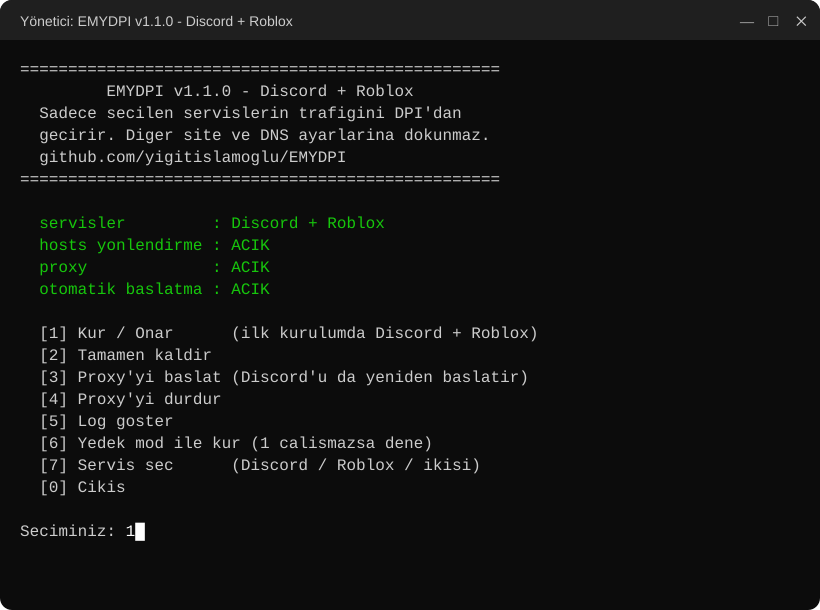

<p align="center">
  
</p>

<p align="center">
  <a href="https://github.com/yigitislamoglu/EMYDPI/releases/latest"></a>
  <a href="https://github.com/yigitislamoglu/EMYDPI/releases"></a>
  
  <a href="LICENSE"></a>
  <a href="https://github.com/yigitislamoglu/EMYDPI/stargazers"></a>
</p>

<p align="center">
  
  
</p>

<p align="center">
  <a href="https://github.com/yigitislamoglu/EMYDPI/releases/latest/download/EMYDPI.zip">
    
  </a>
</p>

---

**EMYDPI**, Türkiye'deki **Discord** ve **Roblox** engellerini aşmak için yazılmış küçük ve açık kaynaklı bir araçtır.
Sadece seçtiğin servislerin trafiğini etkiler; diğer sitelere, DNS ayarlarına ve internet hızına dokunmaz.

| | |
|---|---|
| 🎮 **Discord + Roblox** | İkisi birden ya da sadece biri. Kurulumda sen seçersin. |
| 🧩 **Harici dosya yok** | `.exe`, `.dll`, sürücü yok. Sadece Windows'ta zaten bulunan PowerShell; tüm kod açık ve okunabilir. |
| 🔒 **VPN değil** | Trafiğin başka bir sunucuya gitmez, doğrudan Discord'a / Roblox'a bağlanırsın. Ping artmaz. |
| 🎯 **Sadece seçtiğin servisler** | Yalnızca o servislerin alan adları yönlendirilir, geri kalan her şey normal yolundan gider. |
| 🛡️ **Uygulamalara dokunmaz** | DLL enjekte etmez, Discord'un veya Roblox'un dosyalarını değiştirmez. Güncellemeler sorun çıkarmaz. |
| ⚡ **Kur ve unut** | Bilgisayar her açıldığında arka planda, pencere açmadan kendiliğinden çalışır. |

## 🚀 Kurulum

1. **[EMYDPI.zip](https://github.com/yigitislamoglu/EMYDPI/releases/latest/download/EMYDPI.zip)** dosyasını indir
   ve bir klasöre çıkar (örneğin `Belgeler\EMYDPI`).
2. `EMYDPI.bat` dosyasına çift tıkla, yönetici iznine **Evet** de.
3. Menüden **`[1] Kur / Onar`** seç. Discord ve Roblox birlikte kurulur.
   Sadece birini istiyorsan **`[7] Servis seç`** kullan.

Hepsi bu. Discord kendiliğinden yeniden açılır; Roblox'u da normal şekilde açabilirsin. 🎉

<p align="center">
  
</p>

> [!IMPORTANT]
> Klasörü kurulumdan sonra **taşıma veya silme**; otomatik başlatma bu klasördeki dosyaları kullanır.
> Taşıman gerekirse yeni yerinde `[1] Kur / Onar`'ı bir kez daha çalıştır.

> [!WARNING]
> **Kaspersky vb. antivirüs kullanıyorsan:** kurulum Windows'un `hosts` dosyasına birkaç satır ekler. Bazı
> antivirüsler bu dosyayı korur ve **"hosts dosyasına yazma ENGELLENDİ"** hatası görürsün. Antivirüsü birkaç
> dakikalığına duraklat, kurulumu tekrar çalıştır, sonra antivirüsü geri aç. Bu sadece kurulum, servis değiştirme ve
> kaldırmada gerekir.

### v1.0.0'dan güncelliyorsan

Yeni ZIP'i **aynı klasöre** çıkarıp dosyaların üzerine yaz. Sonra `EMYDPI.bat` → **`[7] Servis seç`** →
**`[1] Discord + Roblox`** seç. (`[1] Kur / Onar` mevcut ayarını korur, yani sadece Discord kalır.)

## 📋 Menü

| Seçenek | Ne yapar |
|---|---|
| `[1] Kur / Onar` | hosts kayıtlarını ekler, proxy'yi başlatır, açılışta otomatik çalışmayı ayarlar. Mevcut servis seçimini korur; ilk kurulumda Discord + Roblox |
| `[2] Tamamen kaldır` | Her şeyi geri alır: proxy, otomatik başlatma, hosts kayıtları |
| `[3] Proxy'yi başlat` | Proxy'yi (yeniden) başlatır, Discord'u yeniden açar |
| `[4] Proxy'yi durdur` | Proxy'yi durdurur (kurulum kalır) |
| `[5] Log göster` | Son bağlantı kayıtlarını gösterir |
| `[6] Yedek mod ile kur` | `[1]` işe yaramazsa farklı bir atlatma yöntemiyle kurar |
| `[7] Servis seç` | Discord + Roblox / sadece Discord / sadece Roblox |

## 🔍 Nasıl çalışıyor?

<p align="center">
  
</p>

Türkiye'deki engeller **DPI / SNI** tabanlıdır. HTTPS bağlantısı başlarken, gidilmek istenen sitenin adı (SNI)
şifrelenmemiş olarak gönderilir. Operatör bu paketi okur, içinde `discord.com` veya `roblox.com` görürse bağlantıyı
keser. Discord'da buna ek olarak DNS engeli de vardır. Bu yüzden sadece DNS'i değiştirmek **yetmez**.

EMYDPI şöyle aşar:

1. `hosts` dosyası seçilen servislerin alan adlarını bilgisayarın kendisine (`127.0.0.1`) yönlendirir.
2. Yerel **EMYDPI proxy** bağlantıyı karşılar ve gerçek IP'yi **şifreli DNS (DoH)** ile bulur (1.1.1.1 / 8.8.8.8).
3. TLS **ClientHello** paketini alan adının ortasından **iki ayrı TLS kaydına** böler ve ayrı paketlerle gönderir.
   DPI alan adının tamamını göremediği için bağlantıyı kesmez.

Şifreli trafik **çözülmez veya değiştirilmez**; proxy sadece ilk paketi böler, gerisini olduğu gibi aktarır.
Bu yüzden sertifika kurulumu da gerekmez.

> [!NOTE]
> **Roblox oyun sunucuları** (oyun içi bağlantı) UDP ile doğrudan IP'ye bağlanır ve şu an engelli değildir; proxy'den
> geçmesine gerek yoktur. EMYDPI Roblox'un giriş, site, API ve oyuna katılma bağlantılarını açar.

📖 **Ayrıntılı teknik açıklama:** [NASIL-CALISIR.md](NASIL-CALISIR.md). Engelin nasıl uygulandığını, bir bağlantının
adım adım yolculuğunu, kurulumda ve bilgisayar açılışında neler olduğunu orada bulabilirsin.

<details>
<summary><b>Dosyalar ve sisteme yapılan değişiklikler</b></summary>

| Dosya | Görev |
|---|---|
| [`EMYDPI.bat`](EMYDPI.bat) | Menü, yönetici izni ister |
| [`emydpi.ps1`](emydpi.ps1) | Kurulum/kaldırma, servis listeleri, hosts ve zamanlanmış görev yönetimi |
| [`emydpi-proxy.cs`](emydpi-proxy.cs) | Proxy'nin kendisi (C#, çalışırken PowerShell tarafından derlenir) |
| [`emydpi-proxy.ps1`](emydpi-proxy.ps1) | Proxy'yi derleyip başlatır |

**Sisteme yapılan değişiklikler:**

- `C:\Windows\System32\drivers\etc\hosts` dosyasına `# >>> EMYDPI` ile başlayan bir blok eklenir.
  İlk değişiklikten önce yedeği `hosts.emydpi.bak` olarak alınır.
- Görev Zamanlayıcı'ya **EMYDPI** adlı, oturum açılışında çalışan bir görev eklenir. Bu görev yönetici yetkisiyle
  değil, normal kullanıcı olarak ve pencere açmadan çalışır.

`[2] Tamamen kaldır` bunların hepsini geri alır.

**Yönlendirilen alan adları:**

- **Discord:** `discord.com`, `discord.gg`, `discordapp.com`, `discordapp.net`, `discord.media`, `discordcdn.com`
  ve alt alan adları (26 adres)
- **Roblox:** `roblox.com`, `www.roblox.com`, `apis.roblox.com`, `auth.roblox.com`, `gamejoin.roblox.com`,
  `assetdelivery.roblox.com` ve diğer API adresleri (62 adres). `rbxcdn.com` engelli olmadığı için eklenmez.

Tam liste [`emydpi.ps1`](emydpi.ps1) içindedir.

</details>

<a id="performans"></a>
## ⚡ Performans: bilgisayarı yormaz

EMYDPI arka planda sürekli çalışır ama **hissedilmez**. Aşağıdaki değerler gerçek ölçümlerdir:

| Durum | CPU kullanımı | Bellek |
|---|---|---|
| 💤 Boşta | **%0** | ~7 MB |
| 💬 1 saat normal Discord kullanımı | toplam **2,7 saniye** (ortalama %0,0025) | ~7 MB |
| 📥 102 MB dosya indirme, tam hız | işlemcinin **%0,28**'i | ~85 MB |
| 🔀 100 eşzamanlı bağlantı | 0,5 saniye, hepsi başarılı | ~85 MB |

- **Hız kaybı yok:** Aynı 102 MB'lık dosya doğrudan bağlantıda 8,0 MB/sn, EMYDPI üzerinden 9,7 MB/sn indi.
  Sınır senin internet hattın.
- **Ping artmaz:** Proxy senin bilgisayarında çalışır; trafik VPN gibi başka bir ülkeye gitmez.
- **Oyunları etkilemez:** Roblox oyun trafiği, Discord sesli/görüntülü sohbet ve diğer tüm programlar proxy'den
  hiç geçmez.
- **Neden bu kadar hafif?** Proxy sadece her bağlantının ilk paketini (birkaç yüz bayt) böler, gerisini olduğu gibi
  aktarır. CPU'yu en çok yoran şifreleme işlemi yapılmaz.

<a id="guvenlik"></a>
## 🛡️ Güvenlik ve VirusTotal

<p>
  <a href="https://www.virustotal.com/gui/file/9d6e981e0996ecdda762a877cf442f6846e70a7b1104dd9f96546dd0c1701441"></a>
</p>

✅ **VirusTotal: 0/64.** EMYDPI v1.1.0, 64 antivirüs motorunun **hiçbiri** tarafından zararlı veya şüpheli
bulunmadı (Avast, AVG, BitDefender, CrowdStrike, Kaspersky, ESET, Microsoft ve diğerleri).
[Sonucu kendin gör →](https://www.virustotal.com/gui/file/9d6e981e0996ecdda762a877cf442f6846e70a7b1104dd9f96546dd0c1701441)

EMYDPI'de **derlenmiş tek bir dosya bile yoktur**: `.exe`, `.dll` veya sürücü bulunmaz. Dört metin dosyasından
oluşur ve her satırı okunabilir. İnternetten hiçbir şey indirmez, hiçbir sunucuya veri göndermez.
Ayrıntılar için [NASIL-CALISIR.md → Güvenlik](NASIL-CALISIR.md#7-güvenlik-ne-yapar-ne-yapmaz).

**İndirdiğin dosyanın değiştirilmediğini doğrula.** İndirdiğin ZIP'in SHA256 değeri aşağıdakiyle aynı olmalı:

```powershell
Get-FileHash .\EMYDPI.zip -Algorithm SHA256
```

| Dosya (v1.1.0) | SHA256 |
|---|---|
| `EMYDPI.zip` | `9d6e981e0996ecdda762a877cf442f6846e70a7b1104dd9f96546dd0c1701441` |
| `EMYDPI.bat` | `5cbf3836cffd0ab86833b722ed3c79112f453b73d0bfcd576fb26250479fdbb2` |
| `emydpi.ps1` | `7c37bdbfb39908f4f320d78d6d11dc9736cd0406b74cebf08a1151f77dd72dac` |
| `emydpi-proxy.ps1` | `2ce308f3d692cc57aced3ce6b5b6e002219e0a786602e0d23af396a6ccc10e64` |
| `emydpi-proxy.cs` | `368a855fe3105499605b50d3c2d26542ea2824a6545a2990279a43bec947d407` |

> [!NOTE]
> EMYDPI'yi **sadece bu GitHub sayfasından** indir. Başka sitelerde veya Discord sunucularında paylaşılan
> kopyalar değiştirilmiş olabilir. Bazı antivirüsler `hosts` dosyasını değiştiren her betiği şüpheli sayabilir;
> kodu kendin inceleyebilir veya yukarıdaki VirusTotal sonucuna bakabilirsin.

## 🛠️ Sorun giderme

<details>
<summary><b>Discord "Checking for updates…" ekranında kalıyor</b></summary>

`[5] Log göster`'e bak. Satırlar görünüyorsa proxy çalışıyordur; `[6] Yedek mod ile kur`'u dene.
Hiç satır yoksa `[3] Proxy'yi başlat`'ı dene.
</details>

<details>
<summary><b>Roblox açılmıyor veya oyuna girmiyor</b></summary>

1. `[5] Log göster`'de `roblox.com` satırları görünüyor mu bak. Görünmüyorsa `[7] Servis seç` ile Roblox'un kurulu
   olduğundan emin ol.
2. Roblox'u görev yöneticisinden tamamen kapatıp yeniden aç.
3. Logda `cozulemedi` veya `hata` yazan bir Roblox adresi varsa, ya da hiç görünmeyen bir adres yüzünden takılıyorsa
   lütfen bir [Issue](https://github.com/yigitislamoglu/EMYDPI/issues) aç. Listeye ekleyelim.
</details>

<details>
<summary><b>"443 portunu başka bir program kullanıyor"</b></summary>

Bilgisayarında 443 portunu dinleyen bir program var (yerel web sunucusu, IIS, XAMPP, bazı VPN'ler vb.).
O programı kapatıp `[3]`'ü çalıştır.
</details>

<details>
<summary><b>Discord'a / Roblox'a erişim tamamen gitti</b></summary>

Proxy kapalıyken hosts kayıtları duruyorsa bağlantı olmaz. `[3]` ile proxy'yi başlat ya da `[2]` ile tamamen kaldır.
</details>

<details>
<summary><b>Discord'da sesli sohbet çalışmıyor</b></summary>

Ses sunucuları sürekli değişen adlar kullandığı için proxy'den geçmez. Bu yazıldığı tarihte sesli sohbet engelli
değildi; ileride engellenirse lütfen bir [Issue](https://github.com/yigitislamoglu/EMYDPI/issues) aç.
</details>

<details>
<summary><b>Kaldırmak istiyorum</b></summary>

`EMYDPI.bat` → `[2] Tamamen kaldır`. Ardından klasörü silebilirsin. Antivirüs hosts dosyasını koruyorsa kaldırma
sırasında da kısa süre duraklatman gerekir.
</details>

## ❓ Sık sorulan sorular

**Güvenli mi?** Tüm kod açık ve birkaç yüz satır. İnternetten hiçbir dosya indirmez, hiçbir şey çalıştırmaz.
Tek dış bağlantısı, gerçek IP adreslerini öğrenmek için Cloudflare (1.1.1.1) ve Google (8.8.8.8) şifreli DNS
sunucularına yapılan sorgulardır. VirusTotal sonucu ve dosya özetleri için [Güvenlik](#guvenlik) bölümüne bak.

**Bilgisayarımı yavaşlatır mı?** Hayır. Boşta %0 CPU ve ~7 MB RAM kullanır. Ölçümler [Performans](#performans)
bölümünde.

**Oyunlarda ping'imi artırır mı?** Hayır. VPN değildir; seçilen servisler dışındaki trafiğe dokunmaz. Roblox oyun
trafiği zaten proxy'den geçmez, doğrudan sunucuya gider.

**Roblox hesabım banlanır mı?** EMYDPI Roblox istemcisine veya oyunlara hiçbir şekilde müdahale etmez; sadece
bağlantının operatör tarafından kesilmesini engeller. Roblox açısından normal bir bağlantıdan farkı yoktur.

**GoodbyeDPI / zapret'ten farkı ne?** Onlar WinDivert sürücüsüyle tüm sistemin trafiğini işler. EMYDPI sürücü
kurmaz, sadece seçilen servislerin bağlantılarına müdahale eder.

**Tarayıcıdan girebilir miyim?** Evet, discord.com ve roblox.com tarayıcıdan da açılır. Açılmazsa tarayıcının
"Güvenli DNS" (DoH) ayarını kapatıp tekrar dene; bazı tarayıcılar bu ayar açıkken `hosts` dosyasını atlayabilir.

**Başka bir site/oyun eklenebilir mi?** Aynı yöntemle SNI engeli olan başka servisler de eklenebilir.
İsteğini [Issue](https://github.com/yigitislamoglu/EMYDPI/issues) olarak aç.

## 🤝 Katkı

Hata bildirmek, öneride bulunmak veya geliştirmeye katkıda bulunmak için
[Issue](https://github.com/yigitislamoglu/EMYDPI/issues) veya Pull Request açabilirsin.
Projeyi faydalı bulduysan ⭐ vermeyi unutma.

## ⚖️ Sorumluluk reddi

Bu proje eğitim amaçlıdır ve kişisel kullanım içindir. Kullanımından doğabilecek her türlü sorumluluk kullanıcıya
aittir. Proje Discord Inc. veya Roblox Corporation ile hiçbir şekilde bağlantılı değildir.

## 📄 Lisans

[MIT](LICENSE) © Yiğit Can İslamoğlu
